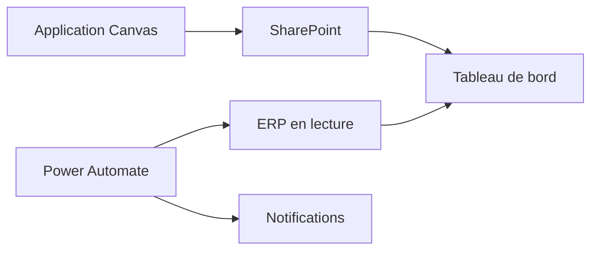
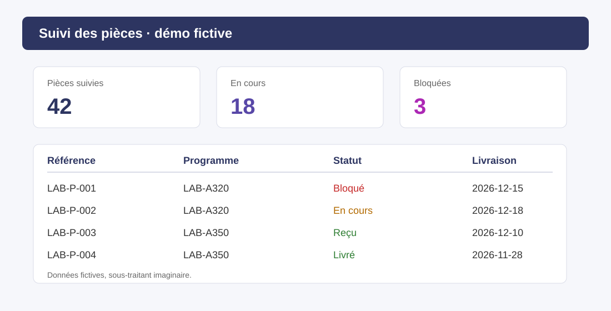

# Power Platform et applications métier

Une application métier utile en trois jours, même avec des licences restreintes.

*Power Platform case studies: Power Apps, Power Automate, Microsoft Lists and SharePoint under real constraints.*

## Ce que je peux faire pour vous

- **Conseil** : cadrage des besoins, choix des outils, audit Microsoft Lists et SharePoint.
- **Automatisation** : Power Apps, Power Automate, applications métier low-code.
- **Formation** : Power Apps, Power Automate, Microsoft Lists, SharePoint.

## Cas 1 · suivi de pièces aéronautiques

### Contexte

Un industriel de l'aéronautique en environnement sécurisé. Le suivi des pièces se fait dans des fichiers dispersés. L'objectif : une application unique, lisible et connectée à SharePoint.

### Intervention

Formation et construction. 3 jours, présentiel, intra. 2026.

### Démarche

1. Cadrer les données et les trois écrans utiles.
2. Construire une Canvas App connectée à SharePoint.
3. Contourner les licences restreintes en session, sans Dataverse ni AI Builder.

### Résultat

- Une application de suivi de pièces.
- Un jeu de données fictif.
- Une équipe capable de maintenir l'application.

### Point dur surmonté

Les licences étaient restreintes. Plutôt que de promettre Dataverse ou AI Builder, la session a construit l'application avec SharePoint et des formules Power Fx simples.

## Cas 2 · équipements sanitaires et ERP

### Contexte

Un fabricant d'équipements sanitaires. Les équipes métier et support veulent mieux exploiter Microsoft 365 et Power Platform, avec un ERP sur SQL Server et un premier tableau de bord.

### Intervention

Formation. 5 jours, hybride, intra. 2026.

### Démarche

1. Cadrer les flux et les données disponibles.
2. Travailler Microsoft 365 et Power Platform.
3. Construire un premier tableau de bord Power BI, sans DAX.

### Résultat

- Des requêtes Power Query réutilisables.
- Un tableau de bord simple.
- Des supports pour continuer.

### Point dur surmonté

L'ERP sur SQL Server n'était pas ouvert à tous. L'accès a été limité en lecture et les données de démonstration ont été anonymisées.

## Cas 3 · Microsoft Lists pour un industriel

### Contexte

Un industriel veut remplacer un suivi papier par une liste structurée, partagée et filtrable. Les équipes ont besoin de saisir, consulter et relancer sans ressaisie.

### Intervention

Conseil et construction. 2026.

### Démarche

1. Cadrer les champs, les vues et les droits.
2. Construire la liste, les formulaires et les vues filtrées.
3. Ajouter les relances et les alertes simples.

### Résultat

- Un suivi partagé et filtrable.
- Des formulaires de saisie.
- Des relances automatiques.

### Point dur surmonté

Les équipes avaient des habitudes de saisie très différentes. Les vues ont été construites par rôle, avec un socle commun.

## Architecture

## Démo exécutable

Une seule démo générique : [`demo/LAB-pieces-aeronautiques.csv`](demo/LAB-pieces-aeronautiques.csv) et [`demo/formules.md`](demo/formules.md). Quatre formules Power Fx, un jeu de données fictif, aucun nom de client.

## Captures de démos fictives

## Autres interventions

- Dématérialisation de processus papier vers Power Automate sur un site industriel.

## Me contacter

- Site : https://next-gen-ai.fr
- LinkedIn : https://www.linkedin.com/in/adam-ai-011540356

---

*La démo est sous licence MIT, voir `LICENSE`. Le reste du contenu est sous tous droits réservés.*
